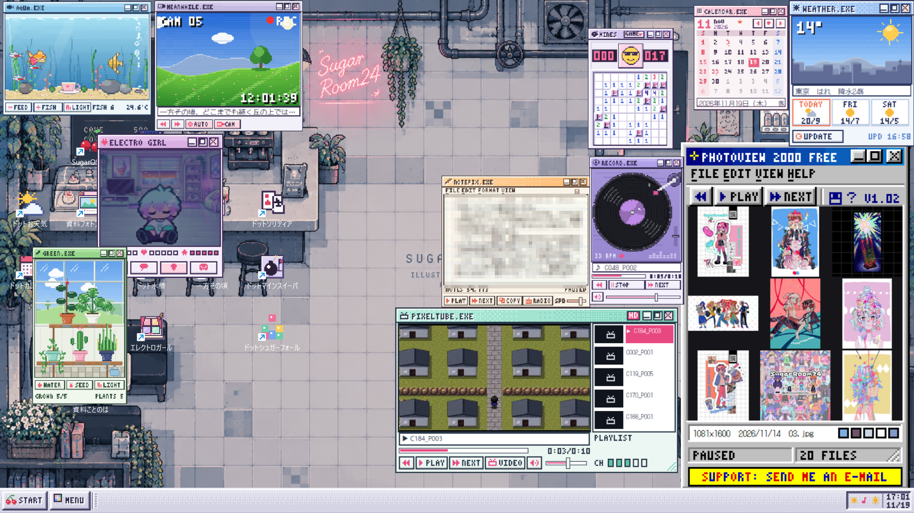
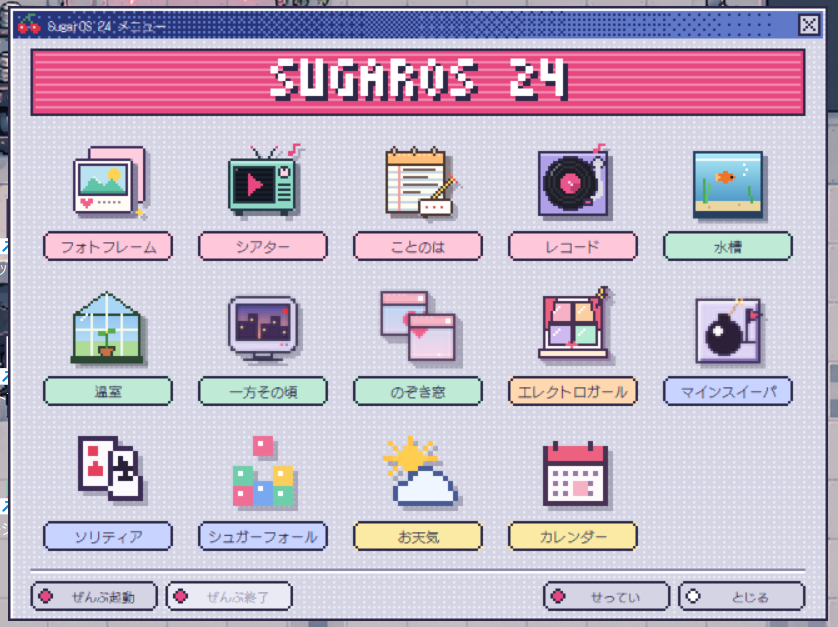
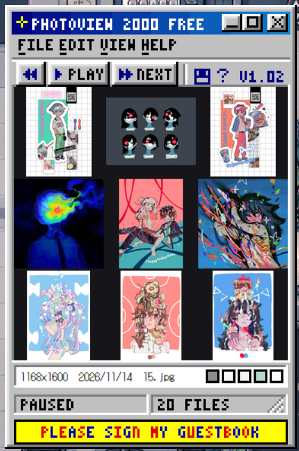
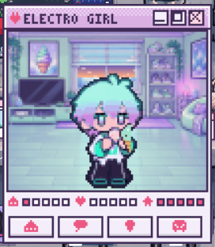

# SugarOS 24

**外付けHDDに眠っている参考資料を「虫干し」するための、ドット絵のデスクトップツール群です。**

2013年から Eagle にためてきた資料（画像・動画・音声）や、昔のメモ・テキストを、
デスクトップの片すみでランダムに流して、なんとなく眺めるために作りました。

雰囲気は、ヴェイパーウェイブ／ドリームコア／オールドウェブ／かわいいドット絵／無機質なカフェと甘いもの。
架空のOS「SugarOS 24」として、ランチャーのバーから小さなツールを呼び出して使います。

> [!NOTE]
> **自分用に作ったものです。** 「こんなのを作りました」という紹介のための公開で、動作の保証やサポートはしていません。
> Windows 10 / 11 でしか動かしていません。
> コードの大部分は、AI（Claude）に書いてもらいました。



---

## なにができるの？

ランチャーのバーの **MENU** を押すと、大きなアイコンが並んだメニュー画面が開いて、そこから次のツールを起動できます（START のメニューからも起動できます）。
ツール同士はゆるくつながっていて、お天気が雨ならほかのツールの窓にも雨が降ったり、
レコードをかけるとエレクトロガールがときどきノッてくれたり、昼と夜で見た目が変わったりします。

### 資料を流す
| ツール | ファイル | なにをする？ |
|---|---|---|
| 資料フォトフレーム | `photo_frame.pyw` | フォルダ（または Eagle ライブラリ）の画像を、選んだフォルダやタグからランダムに表示。SNS風・デスクトップ風の2つの見た目 |
| 資料シアター | `video_theater.pyw` | フォルダ（または Eagle ライブラリ）の動画・音声をランダムに再生 ※VLC が必要 |
| 資料レコード | `record_player.pyw` | フォルダ（または Eagle ライブラリ）の曲を1曲ずつ流すレコードプレーヤー。たまにスペシャルカラーのレコードが回る ※VLC が必要 |
| 資料ことのは | `kotonoha.pyw` | ChatGPT のエクスポートや txt のメモから、文章をランダムに流す。見た目を「ドット電光掲示板」にすると、文章が1行になって右から左へ流れる |

### 眺める
| ツール | ファイル | なにをする？ |
|---|---|---|
| ドット水槽 | `aquarium.pyw` | 魚がのんびり泳ぐ水槽 |
| ドット温室 | `greenhouse.pyw` | 水をやって、植物を育てる温室 |
| 一方その頃 | `meanwhile.pyw` | どこかの街の「一方その頃」を、防犯カメラのように眺める |
| のぞき窓 | `nozokimado.pyw` | 何枚もの小さな窓で、1枚のキャラ絵（背景が透明の PNG）をのぞくデスクトップアート。ゲーム風・音楽プレーヤー風・ドット絵ツール風・ブラウザ風・SNS風・お絵かきソフト風など10種類の窓と、16種類のエフェクト。開くたびにおまかせで並ぶ |
| ドットネオン街 | `neon_sign.pyw` | 香港の街みたいなネオン看板を、ウィンドウで並べる。ネオン管・LED・ライトアップの看板、縦長・横長、昔のポップアップ広告風や90年代のごちゃまぜポータル風のまど、絵の広告（`neon_ads/` に画像を入れると増やせる）。おまかせで5〜6枚並ぶ |

### 住人
| ツール | ファイル | なにをする？ |
|---|---|---|
| エレクトロガール | `electro_girl.pyw` | デスクトップに住む4人の子たち（キャンディ・ドーナツ・ケーキ・アイス）。おへやは時間と天気で変わる |
| キャラ取り込み | `chara_import.pyw` | 自分で描いた絵やおへやの絵を、エレクトロガールに取り込む（エレクトロガールのメニューからも開ける） |

### 遊ぶ
| ツール | ファイル | なにをする？ |
|---|---|---|
| ドットマインスイーパ | `minesweeper.pyw` | マインスイーパ |
| ドットソリティア | `solitaire.pyw` | ソリティア（クロンダイク） |
| ドットシュガーフォール | `sugarfall.pyw` | 角砂糖を積んで消す、オリジナルの落ちものパズル |

### 道具
| ツール | ファイル | なにをする？ |
|---|---|---|
| ランチャー | `mushiboshi_start.pyw` | START・MENU・時計だけの小さなバー。MENU で大きなアイコンのメニュー画面、START でカラーや昼夜の設定 |
| SugarOS メニュー | `sugar_menu.pyw` | デスクトップから、ランチャーのメニュー画面を開く入口（ランチャーが止まっていれば一緒に起動） |
| ドットお天気 | `weather.pyw` | いまの天気と予報（Open-Meteo を使用。インターネットが必要） |
| ドットカレンダー | `dot_calendar.pyw` | 月ごとのカレンダー |
| ショートカット作成 | `make_shortcuts.pyw` | アイコンつきのショートカットをデスクトップに作る |
| デスクトップ用アイコン | `desktop_icons/` | SugarOS 風のフォルダとゴミ箱（空・いっぱい）のアイコン。ピンク・ミント・ブルー・きいろの4色 |

### おまけ
| なに | ファイル | せつめい |
|---|---|---|
| おまけ壁紙 | `おまけ/SugarRoom24_壁紙.png` | ドット絵のカフェ「Sugar Room24」の壁紙（1672×940）。AI（ChatGPT）で作った絵です。右クリック →「デスクトップの背景として設定」で使えます |

| ランチャーのメニュー画面 | 資料フォトフレーム | エレクトロガール |
|---|---|---|
|  |  |  |

---

## 動かし方

### 1. Python を入れる
1. [python.org](https://www.python.org/downloads/) から、Windows 用の Python（3.12 以上がおすすめ。作者は 3.14 で動かしています）をダウンロードします。
2. インストーラーの最初の画面で、**「Add python.exe to PATH」にチェック**を入れてから「Install Now」を押します。

### 2. このリポジトリをダウンロードする
GitHub のページの緑の「Code」ボタン →「Download ZIP」でダウンロードして、好きな場所に展開します。

### 3. 必要なライブラリを入れる
展開したフォルダ（`README.md` がある場所）で、アドレスバーに `cmd` と入力して Enter を押すと、黒い画面（コマンドプロンプト）が開きます。そこで次を入力して Enter：

```bash
pip install -r requirements.txt
```

- **資料シアター・資料レコード**を使うときは、[VLC メディアプレーヤー](https://www.videolan.org/)の本体も入れてください。
- うまく入らないときは、まず `pip install pillow` だけでもOKです（VLC を使う2つと、ことのはの読み上げ以外は動きます）。

### 4. 起動する
`sugaros24` フォルダの中の **`mushiboshi_start.pyw` をダブルクリック**すると、画面の下にランチャーのバーが出ます。
**MENU** ボタンを押すとメニュー画面が開くので、アイコンをクリックしてツールを起動します。どのツールも、`.pyw` を直接ダブルクリックしても起動できます。

- `make_shortcuts.pyw` をダブルクリックすると、アイコンつきのショートカットがデスクトップにできます。
- ツールの設定は、だいたい **右クリックのメニュー** から変えられます。

### 5. 資料を流すツールを使うには
資料フォトフレーム・資料シアター・資料レコードは、**ふつうのフォルダ**の画像・動画・音声をそのまま流せます（[Eagle](https://eagle.cool/) がなくても大丈夫です）。
- はじめて起動したときに、流したいフォルダを選びます。中のフォルダも、奥まで全部読みます。
- 右クリック →「読み込み先」→「フォルダを追加…」で、フォルダはいくつでも足せます。
- 右クリックの「フォルダ」で、流すフォルダを選べます。たとえば `画像` の中に `参考資料/人物` と `自力絵` があれば、「画像」（全部）・「参考資料」・「人物」・「自力絵」から選べます。
- [Eagle](https://eagle.cool/) を使っている場合は、右クリック →「読み込み先」→「Eagle のライブラリ」で、ライブラリフォルダ（`〇〇.library`）を選ぶと、タグで選べるようになります。資料フォトフレームの「色縛り」は、Eagle のときだけ使えます。

資料ことのはは、右クリックのメニューから、ChatGPT のエクスポート（`conversations.json`）や txt のフォルダを追加します。

### 6. デスクトップ用アイコンを使うには
- **フォルダ**：フォルダを右クリック →「プロパティ」→「カスタマイズ」→「アイコンの変更」で `desktop_icons/folder_〇〇.ico` を選びます。
- **ゴミ箱**：デスクトップを右クリック →「個人用設定」→「テーマ」→「デスクトップ アイコンの設定」で、「ごみ箱 (空)」に `trash_〇〇_empty.ico`、「ごみ箱 (満杯)」に `trash_〇〇_full.ico` を選びます。

---

## ファイルについて
```
SugarOS24/
├─ README.md            … このファイル
├─ LICENSE              … プログラムのライセンス（MIT）
├─ ASSETS_LICENSE.md    … 絵やキャラクターの扱い
├─ requirements.txt     … 必要なライブラリの一覧
├─ screenshots/         … README の画像
├─ おまけ/              … おまけの壁紙
└─ sugaros24/           … ツール本体
    ├─ mushiboshi_ui.py … 全ツールの共通部品（ドット文字、カラー、天気、保存など）
    ├─ *.pyw            … それぞれのツール
    ├─ *.ico            … ツールのアイコン
    ├─ desktop_icons/   … フォルダとゴミ箱のアイコン
    ├─ neon_ads/        … ドットネオン街の、絵の広告
    └─ electro_girl_data/ … エレクトロガールのキャラ・おへや・おやつ・セリフ
```

- 設定やセーブデータ（`〇〇_config.json` など）は、ツールを使うと `sugaros24` フォルダに自動でできます。
  資料フォルダの場所などの個人の情報が入るので、GitHub には上げないようにしています（`.gitignore`）。
- ファイル名の `mushiboshi`（虫干し）は、SugarOS 24 になる前の名前のなごりです。

## ライセンス
- **プログラム**（`.py` `.pyw`）：[MIT ライセンス](LICENSE)
- **絵・キャラクター・アイコン・セリフ**：MIT ではありません。**再配布・AI学習への利用は禁止**です。くわしくは [ASSETS_LICENSE.md](ASSETS_LICENSE.md) を見てください。

## つかっているもの
- [Pillow](https://python-pillow.org/)（絵を描く・読む）
- [python-vlc](https://pypi.org/project/python-vlc/) と [VLC](https://www.videolan.org/)（動画・音声の再生）
- [Open-Meteo](https://open-meteo.com/)（天気の情報。無料・登録なし）
- ドット風フォント [DotGothic16](https://fonts.google.com/specimen/DotGothic16) が入っていれば、それを使います（なくても動きます）
